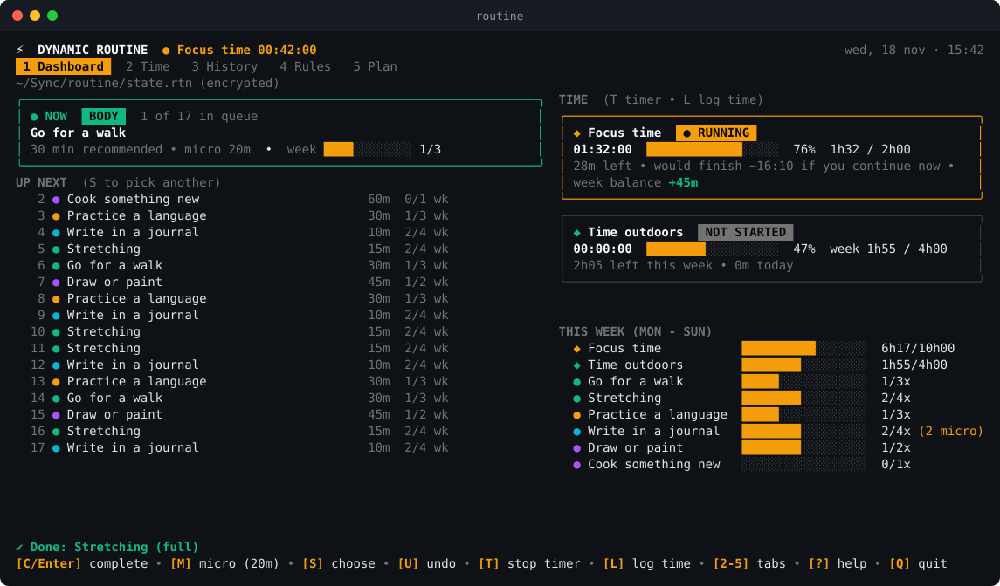
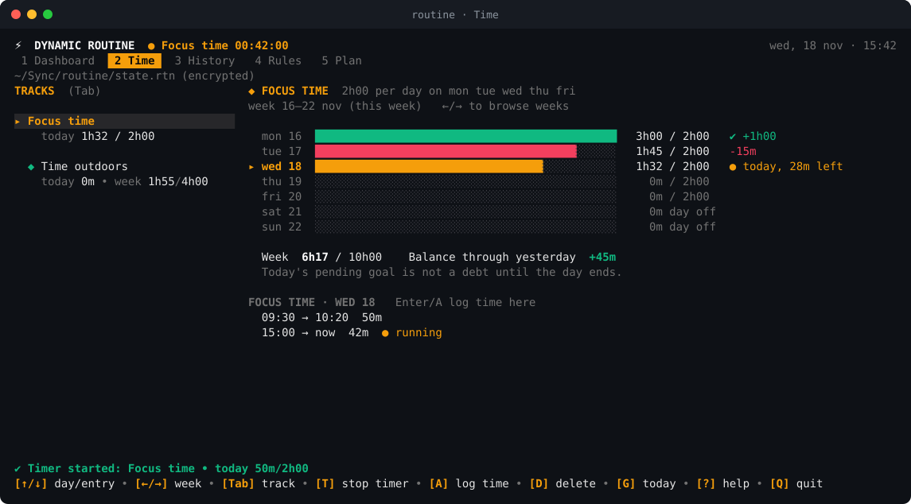
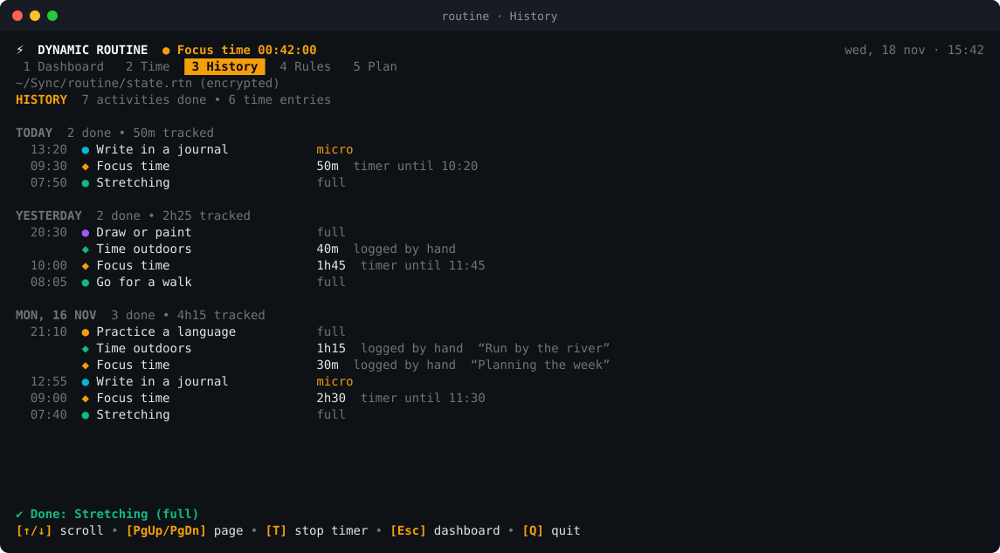
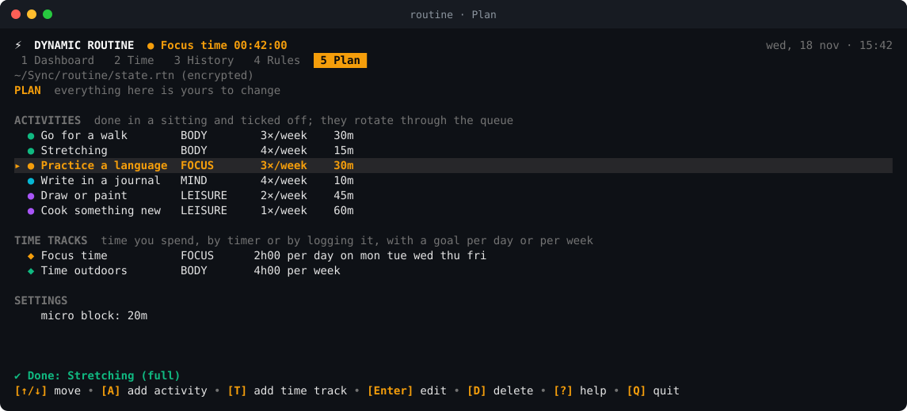
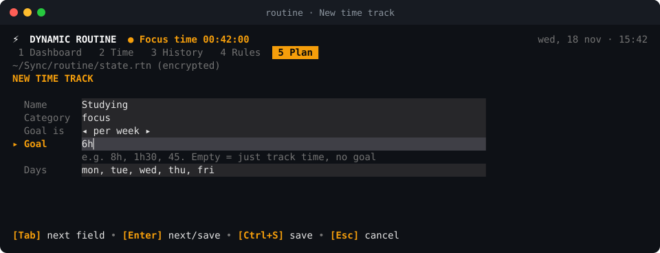
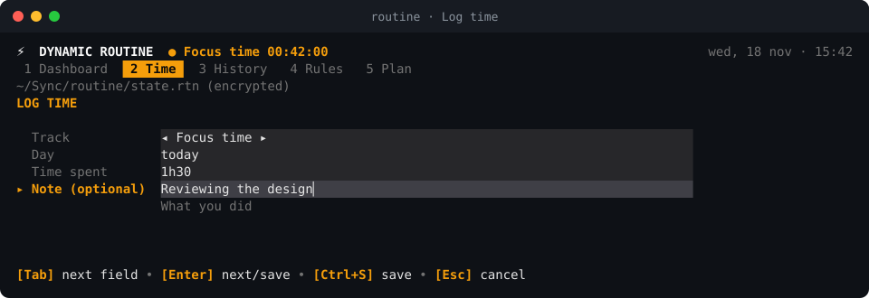
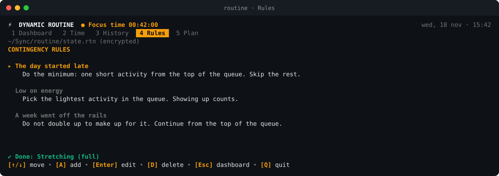
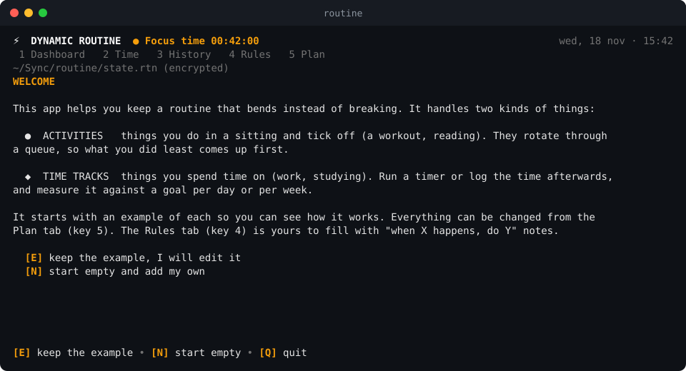
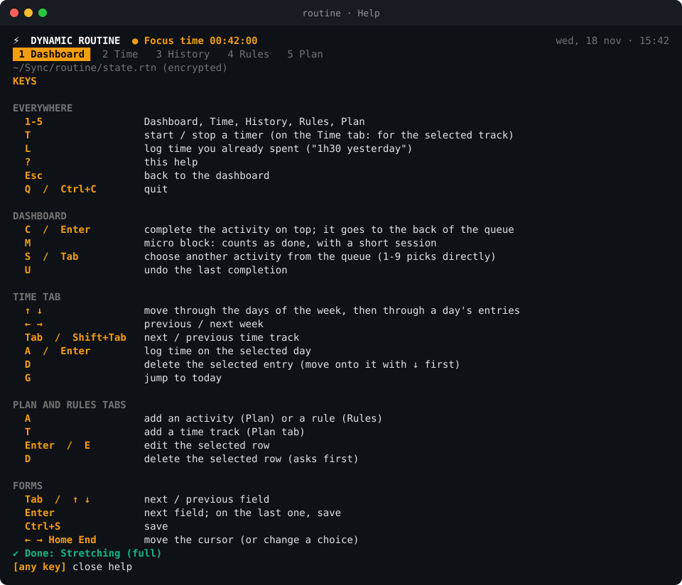
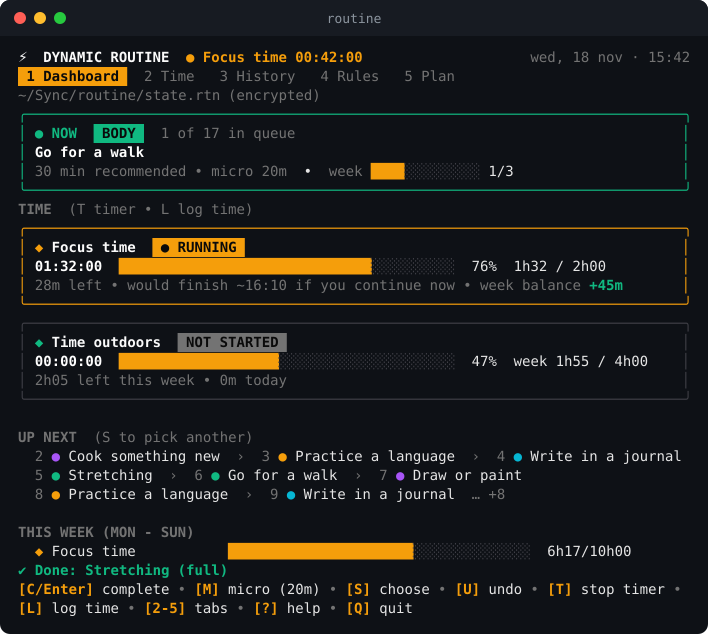

# dynamic-routine

[](https://github.com/DiegoAndradeD/dynamic-routine/actions/workflows/ci.yml)
[](LICENSE)


A terminal app for a routine that **bends instead of breaking**.

Most habit trackers punish you for a missed day. This one does not: what you
skipped simply stays at the front of the line, and the time you owe is shown as
a balance, not a failure. It has two kinds of things to keep track of:

- **Activities** you do in one sitting and tick off (a workout, reading, an
  hour of guitar). They rotate through a priority queue, so whatever you did
  least always comes up first.
- **Time tracks** you spend hours on (work, studying, practice). Fill them with
  a timer or by telling the app afterwards "I spent 1h30 on this yesterday", and
  measure them against a goal per day or per week.

Everything is yours to configure from inside the app, the state is encrypted,
and it is built to live in a folder you already sync (Syncthing, Dropbox,
OneDrive...) so the same routine follows you between Linux and Windows.



## Contents

- [Features](#features)
- [Screenshots](#screenshots)
- [Install](#install)
  - [Linux](#linux)
  - [Windows](#windows)
- [Quick start](#quick-start)
- [Concepts](#concepts)
- [Keyboard reference](#keyboard-reference)
- [Configuration](#configuration)
- [Commands](#commands)
- [Using it on several machines](#using-it-on-several-machines)
- [Encryption](#encryption)
- [Backup and migration](#backup-and-migration)
- [Troubleshooting](#troubleshooting)
- [Development](#development)
- [License](#license)

## Features

- **Priority queue** of activities. Complete the top one, or pull any other to
  the top without penalty. Undo the last completion. Micro blocks for days when
  a full session is too much.
- **Time tracks** with a goal per day (on the days you choose) or per week, or
  no goal at all.
- **Timer and manual logging**: start and stop a timer from any screen, or log
  time after the fact for any day, with a note. You do not have to keep the app
  open all day.
- **Balance, not guilt**: surplus time offsets shortfall across the week; today's
  pending goal is never a debt until the day ends.
- **History** that merges activities done, timer slices and logged time into one
  timeline with daily totals, plus browsing earlier weeks in the Time tab.
- **Contingency rules**: your own "when X happens, do Y" notes for days that do
  not go to plan.
- **No hard-coded routine**: activities, categories and colours, time tracks,
  rules and the micro-block length are all edited in the app (or as TOML).
- **Encrypted state** (scrypt + XChaCha20-Poly1305), safe to leave in a cloud
  drive.
- **Safe sync between machines**: atomic writes, changes made elsewhere are
  picked up while the app is open and never overwritten.
- **Responsive terminal UI** that uses the whole window: two columns on wide
  terminals, one on narrow ones.
- One static binary. No runtime, no installer, no database.

## Screenshots

The data below is the built-in example plan with a made-up week.

**Time tab:** a week per track, with the timer, browsing back through earlier
weeks, and every entry of the selected day.



**History:** activities, timer slices and logged time on one timeline.



**Plan tab:** activities, time tracks and settings, all editable.



**Forms:** adding a time track, and logging time you already spent.




**Rules**, the **first-run welcome**, the **built-in help** (`?`), and the
dashboard on a narrow terminal:






## Install

You need [Go](https://go.dev/dl/) 1.26 or newer. The result is a single
executable you can copy anywhere.

### Linux

```sh
git clone https://github.com/DiegoAndradeD/dynamic-routine.git
cd dynamic-routine
go build -o routine ./cmd/routine
./routine
```

To install it into your `PATH` instead (it lands in `$(go env GOBIN)`, by
default `~/go/bin`):

```sh
go install ./cmd/routine
# or, without cloning:
go install github.com/DiegoAndradeD/dynamic-routine/cmd/routine@latest
```

### Windows

1. **Install Go.** Download the installer from <https://go.dev/dl/>, or from a
   terminal:

   ```powershell
   winget install GoLang.Go
   ```

   Open a **new** terminal afterwards so `go` is on the `PATH`, and check with
   `go version`.
2. **Get the code and build** (in PowerShell or Windows Terminal):

   ```powershell
   git clone https://github.com/DiegoAndradeD/dynamic-routine.git
   cd dynamic-routine
   go build -o routine.exe .\cmd\routine
   .\routine.exe
   ```

   No C compiler is needed: the build is pure Go.
3. **Put it on your `PATH`** so you can just type `routine` anywhere. Either
   install it with Go (it goes to `%USERPROFILE%\go\bin`, which the Go installer
   adds to the `PATH`):

   ```powershell
   go install .\cmd\routine
   ```

   or copy `routine.exe` to a folder you keep for tools and add that folder to
   the `PATH` (Settings → System → About → Advanced system settings →
   Environment Variables).

Use [Windows Terminal](https://aka.ms/terminal) for the best result: it handles
the colours, box-drawing characters and resizing the interface relies on.

**Cross-compiling for Windows from Linux** (no Windows machine needed to build):

```sh
GOOS=windows GOARCH=amd64 go build -o routine.exe ./cmd/routine
```

Use `GOARCH=arm64` for Windows on ARM. The same trick builds for macOS
(`GOOS=darwin`), where it should work the same way.

Check the install with `routine version`.

## Quick start

Run `routine`. The first time, the app:

1. creates its config file (see [where](#where-things-are-stored)),
2. asks you to **choose a passphrase** (twice) that encrypts your data. Pick
   something you will remember: there is no recovery,
3. shows a welcome screen. Press **E** to keep the example plan and edit it, or
   **N** to start empty.

Then, a five-minute tour:

1. **Make it yours.** Press `5` (Plan). `A` adds an activity: a name, a
   category, how many times a week, and how long a session is. `T` adds a time
   track: a name, whether the goal is per day or per week, the goal (`8h`,
   `1h30`, `45`...), and the days. `Enter` edits the selected row, `D` deletes
   it. Press `4` for Rules and write a few "when X, do Y" notes.
2. **Do something.** Press `1` (Dashboard). The card at the top is what to do
   now. Do it, then press `C` to complete it: it goes to the back of the queue.
   Short on time? `M` counts a micro block. Not in the mood for it? `S` lets you
   pick anything from the queue instead, and nothing is marked as missed.
   Pressed `C` by mistake? `U` undoes it.
3. **Track some time.** Press `T`. With several tracks it asks which one; with
   one it starts right away. The header shows the running clock on every screen.
   Press `T` again to stop. The timer is saved, so closing the app does not lose
   it.
4. **Log time you forgot to track.** Press `L`. The form opens on the time field:
   type how long (`45`, `1h30`, `1:30`). Press `↑` to change the day (`today`,
   `yesterday` or `2026-11-16`) or the track (`←/→`), and `↓` for an optional
   note, then `Ctrl+S`.
5. **Look back.** `2` (Time) shows a week per track; `←/→` browses earlier weeks,
   `↓` moves onto a day's entries and `D` deletes one. `3` (History) is the
   whole timeline.

Press `?` at any time for the key reference.

## Concepts

### Activities and the queue

An activity is something you do in one sitting: *Workout*, *Read a book*,
*Practice guitar*. Each has:

| Field | Meaning |
| --- | --- |
| Name | What it is called. |
| Category | A free label that gives it a colour (`body`, `focus`, `leisure`... or your own). |
| Times per week | The weekly target. It is also **how many times the activity sits on the queue**. |
| Minutes per session | How long a full session is recommended to be. |

The queue is a conveyor belt. The first item is what to do now. When you
complete it, it goes to the back, so activities with more weekly slots come up
more often and nothing is ever "late": whatever you skipped is still waiting at
the front.

- **Complete (`C` / `Enter`)** logs the activity as a full session.
- **Micro (`M`)** logs it as a micro block (20 minutes by default, configurable).
  It counts toward the weekly target, and is tagged "micro" so you can see it.
- **Choose (`S`)** opens the whole queue and pulls any item to the top. You can
  do this as often as you like. The rest keeps its order and nothing is logged as
  a miss, so the queue still reflects your priorities.
- **Undo (`U`)** reverts the last completion and puts the activity back on top.

The dashboard's scoreboard counts completions per activity from Monday 00:00,
against the weekly targets.

### Time tracks

A time track is something you spend *time* on instead of ticking off: *Work*,
*Studying*, *Time outdoors*. You can have as many as you like. Each has:

| Field | Meaning |
| --- | --- |
| Name, category | As for activities. |
| Goal is | **per day** or **per week**. |
| Goal | The target time, written the way you would say it: `8h`, `1h30`, `45`. Empty means "just track, no goal". |
| Days | For a per-day goal, the days it counts on (`mon, tue, wed, thu, fri`). Empty means every day. |

You add time in two ways, and can mix them freely:

- **Timer.** `T` starts and stops it from any screen. Only one timer runs at a
  time: starting another one stops the first and records its slice. A slice that
  crosses midnight is split between the two days.
- **Logging.** `L` (or `A` in the Time tab) records time you already spent, on
  any day up to today, with an optional note. A single entry is at most 24 hours.

**Balance.** For per-day goals the Time tab shows a *balance*: time worked minus
the goal, over the days that are already over. A surplus on Monday offsets a
shortfall on Tuesday. It is information, not a punishment, and today's pending
goal is not counted as a debt until the day ends. Per-week goals just show what
is left of the week.

**Weeks** run from Monday to Sunday. In the Time tab `←/→` moves between weeks, so
you can fix last week's forgotten timer.

### History

The History tab merges everything into one timeline, newest day first, with
daily totals (`3 done • 2h40 tracked`): the activities you completed, the timer
slices, and the time you logged by hand. It covers the last 120 days.

### Rules

Rules are your own contingency notes: *when* something happens, *then* do
something. For example *"I slept badly"* → *"Only do the lightest activity and
rest."* They are for days that do not go to plan, so you decide once, calmly,
instead of deciding while tired. A new plan has none; the empty Rules tab shows
a few greyed-out examples of what to write.

### The plan

Everything above (activities, time tracks, categories and colours, rules and the
micro-block length) is the **plan**. It is edited in the Plan and Rules tabs, or
in bulk with `routine edit`. The plan lives inside the state file, so it follows
you between machines. Deleting an activity or a track removes it from the plan
but **keeps its history**.

## Keyboard reference

Press `?` in the app to see this list.

**Everywhere**

| Key | Action |
| --- | --- |
| `1` `2` `3` `4` `5` | Dashboard, Time, History, Rules, Plan |
| `T` | Start / stop a timer (on the Time tab: for the selected track; on the Plan tab: add a time track) |
| `L` | Log time you already spent |
| `?` | Help |
| `Esc` | Back to the dashboard |
| `Q`, `Ctrl+C` | Quit |

**Dashboard**

| Key | Action |
| --- | --- |
| `C`, `Enter` | Complete the activity on top |
| `M` | Complete it as a micro block |
| `S`, `Tab` | Choose another activity from the queue (`↑/↓` and `Enter`, or `1`-`9`) |
| `U` | Undo the last completion |

**Time tab**

| Key | Action |
| --- | --- |
| `↑` `↓` | Move through the days of the week, then through the selected day's entries |
| `←` `→` | Previous / next week |
| `Tab`, `Shift+Tab` | Next / previous time track |
| `A`, `Enter` | Log time on the selected day |
| `D` | Delete the selected entry (move onto it with `↓` first) |
| `G` | Jump to today |

**History tab**: `↑` `↓` scroll, `PgUp` `PgDn` page, `G` top.

**Plan and Rules tabs**

| Key | Action |
| --- | --- |
| `↑` `↓` | Move |
| `A` | Add an activity (Plan) or a rule (Rules) |
| `T` | Add a time track (Plan) |
| `Enter`, `E` | Edit the selected row |
| `D` | Delete the selected row (asks first) |

**Forms**

| Key | Action |
| --- | --- |
| `Tab`, `↓` / `Shift+Tab`, `↑` | Next / previous field |
| `Enter` | Next field; on the last field, save |
| `Ctrl+S` | Save |
| `←` `→` `Home` `End` | Move the cursor (on a choice field, change the choice) |
| `Delete`, `Backspace`, `Ctrl+U` | Delete a character / clear the field |
| `Esc` | Cancel |

A form that is wrong (a missing name, a time it cannot read, a future date) stays
open and tells you what to fix.

### Writing times and days

| You type | Means |
| --- | --- |
| `45`, `45m` | 45 minutes |
| `1h`, `2H` | 1 hour, 2 hours |
| `1h30`, `1h30m` | 1 hour 30 minutes |
| `1:30` | 1 hour 30 minutes |
| `1.5h` | 1 hour 30 minutes |
| `today`, `yesterday` | The day |
| `2026-11-16` | A specific day (not in the future) |

## Configuration

There are two layers, and the split is deliberate:

- **The config file** is small and **machine-local**: where the state file is
  and how it is protected. It is not synced.
- **The plan** (activities, tracks, rules, settings) lives **inside the state
  file**, so it is shared by every machine that opens that file.

### Where things are stored

| | Linux | Windows |
| --- | --- | --- |
| Config file | `~/.config/dynamic-routine/config.toml` | `%AppData%\dynamic-routine\config.toml` |
| State file (default) | next to the config: `state.rtn` | next to the config: `state.rtn` |

(`%AppData%` is usually `C:\Users\<you>\AppData\Roaming`.) Set `ROUTINE_CONFIG` to
use another config file, or pass `--config FILE`. Run `routine where` to see the
paths in use.

### config.toml

```toml
# Where the state is stored. "~" and $VARS are expanded; a relative path is
# relative to this file. Empty means next to this file.
state_file = "~/Sync/routine/state.rtn"

# Keep the state encrypted. Strongly recommended in a synced folder.
encrypt = true

# Optional: a command that prints the passphrase on stdout, so you are not
# asked every time. It runs through the shell (sh -c on Linux, cmd /C on Windows).
passphrase_command = "pass show routine"
```

An unknown key in this file is an error, so a typo cannot silently turn
encryption off. With `encrypt = false` the state is plain JSON (`state.json`).

### Environment variables

| Variable | Effect |
| --- | --- |
| `ROUTINE_CONFIG` | Path of the config file. |
| `ROUTINE_PASSPHRASE` | The passphrase, for scripts. Beware: environment variables are visible to other processes of your user. |
| `VISUAL`, `EDITOR` | The editor `routine edit` opens. It may include arguments (`code --wait`). Defaults to `vi` (Linux) or `notepad` (Windows). |

On Windows, set one for the current PowerShell session with
`$env:EDITOR = "code --wait"`, or permanently with
`[Environment]::SetEnvironmentVariable("EDITOR", "code --wait", "User")`.

The passphrase is looked up in this order: `ROUTINE_PASSPHRASE`, then
`passphrase_command`, then a prompt.

### The plan as TOML

`routine edit` opens the whole plan in your editor and applies it when you save.
An invalid plan is rejected with a message and **nothing changes**.

```toml
micro_minutes = 20

[categories]                  # any name, any #RRGGBB colour
body = "#10B981"
focus = "#F59E0B"

[[activity]]
name = "Go for a walk"        # id is optional: made from the name ("go_for_a_walk")
category = "body"
target_per_week = 3           # also how many times it sits on the queue
recommended_minutes = 30

[[track]]
name = "Focus time"
category = "focus"
period = "day"                # "day" or "week"
target_minutes = 120          # per day or per week; 0 = just track, no goal
days = ["mon", "tue", "wed", "thu", "fri"]   # only for "day"; empty = every day

[[rule]]
trigger = "The day started late"
instruction = "Do the minimum: one short activity and whatever time goal you can."
```

What is checked: every activity and track needs a name; ids must be unique;
`target_per_week` and `recommended_minutes` must be at least 1; `period` must be
`day` or `week`; days must be `mon`...`sun`; colours must be `#RRGGBB`; a rule
needs both a trigger and an instruction.

What a change does to your data: raising or lowering `target_per_week` adds or
removes queue entries (new ones are spread evenly); removing an activity drops it
from the queue; removing a time track stops its timer if it was running. History
is never deleted.

## Commands

```
routine [--config FILE] [command]
```

| Command | What it does |
| --- | --- |
| *(none)* | Open the app. |
| `edit` | Edit the plan as TOML in `$VISUAL` / `$EDITOR`. |
| `plan` | Print the plan as TOML. |
| `export` | Print the whole state as JSON. **Decrypted**: handle with care. |
| `merge [FILE...]` | Fold conflict copies (see below) or any other copy of the state into this one. |
| `passwd` | Change the passphrase. |
| `where` | Show the config path, the state path and whether it is encrypted. |
| `version` | Show the version. |
| `help` | Show the usage. |

## Using it on several machines

The app does not talk to any cloud. It writes **one file**, and you point it at a
folder that something else already syncs. That works the same on every OS and
needs no account, no login, no server.

1. Pick a synced folder (Syncthing, Dropbox, OneDrive, Google Drive, a network
   share...).
2. On each machine, set `state_file` in that machine's `config.toml`:

   ```toml
   # Linux
   state_file = "~/Sync/routine/state.rtn"

   # Windows
   state_file = "~/OneDrive/routine/state.rtn"
   ```

   (`~` means your home folder on both systems; forward slashes work on
   Windows.)
3. Use the **same passphrase** on both. If you use `passphrase_command`, it is
   per machine, so each machine can fetch it its own way.

How it stays safe:

- **Atomic writes.** The file is written to a temporary file and renamed into
  place, so a sync tool never sees a half-written file.
- **Nothing is overwritten.** Every change re-reads the file right before
  applying itself. If the other machine saved something a second ago, you keep
  it, and so do they.
- **Live reload.** While the app is open it notices when the sync tool delivers a
  newer file and reloads it (a message appears at the bottom).
- **Conflicts.** If both machines changed the file while offline, the sync tool
  leaves a conflict copy next to it (`state.sync-conflict-...rtn` for Syncthing,
  `state (conflicted copy ...).rtn` for Dropbox). The app shows a warning in the
  header; run `routine merge` to fold the copy's history back in, then delete
  the copy.

Only one timer exists at a time, shared through the file, so a timer started on
one machine is visible on the other.

## Encryption

With `encrypt = true` (the default) the whole state, including the **names of
your activities, tracks and rules**, is encrypted before it touches the disk.
Anyone who finds the file on a drive, in a cloud account or in a backup sees
noise.

- The key is derived from your passphrase with **scrypt** (N = 2^17, r = 8,
  p = 1; about 128 MiB of memory and a third of a second), once per session.
- Every save is sealed with **XChaCha20-Poly1305** under a fresh random 192-bit
  nonce. The file header (format version, scrypt parameters, salt) is bound to
  the ciphertext, so tampering with it is detected, and the app refuses
  scrypt parameters beyond a sane limit, so a hostile file cannot make it
  allocate absurd amounts of memory.
- The format is documented in [`internal/vault/vault.go`](internal/vault/vault.go)
  and tested, including wrong passphrases, flipped bits and truncation.

What it does **not** do:

- It does not protect you from malware already running as you: it can read the
  passphrase from memory, log your keystrokes, or read the plan while you edit it
  (`routine edit` writes it to a private temporary file, in RAM under `/dev/shm`
  on Linux, and removes it afterwards).
- It does not hide that the file exists, its approximate size, or when it
  changes.
- **There is no passphrase recovery.** Lose it and the data is gone. Keep a
  backup of the passphrase (and of the data, see below).

The state file is created readable by you only.

## Backup and migration

**Backup.** `routine export > backup.json` writes the whole state as plain JSON.
That file is **not encrypted**: store it somewhere safe, or encrypt it yourself
(`age`, `gpg`...). It can be restored by copying it to the `state_file` path with
`encrypt = true`: a plain file is accepted and encrypted on the next save.

**Turning encryption on for an existing plain file.** Set `encrypt = true` and
point `state_file` at the existing JSON file. The app reads it, asks for a new
passphrase, and writes it back encrypted.

**From the first version.** Copy the old `routine_state.json` to your
`state_file` path and start the app. History, queue and activities are kept. The
old built-in work quota becomes an ordinary time track called "Work", with its
sessions, adjustments and running timer; rename, change or delete it like any
other.

## Troubleshooting

**"wrong passphrase, or the file is corrupted".** The passphrase does not match,
or the file was modified. The app asks again up to three times; nothing is
changed in the meantime. If a sync tool is mid-upload, wait and retry.

**I lost my passphrase.** The data cannot be recovered. Start over with a new
state file.

**"no terminal to ask the passphrase on".** The app was started without a
terminal (a script, a launcher). Set `ROUTINE_PASSPHRASE` or `passphrase_command`.

**The screen looks cramped or cut off.** The layout adapts down to about 50 columns
by 12 rows; a larger window shows more. Resize and it redraws.

**Colours or box characters look wrong on Windows.** Use Windows Terminal rather
than the legacy console window.

**`routine edit` opens the wrong editor, or none.** Set `EDITOR` (see
[Environment variables](#environment-variables)). For GUI editors use their
"wait" flag (`code --wait`), otherwise the command returns before you finish.

**The timer was running when I closed the app.** It keeps counting: the start
time is saved, so the slice is recorded correctly when you stop it. If you forgot
it overnight, stop it, delete the slice in the Time tab (`D`) and log the real
time with `L`.

**I logged time on the wrong track or day.** Open the Time tab, move onto the
entry with `↓` and press `D`, then log it again.

**A time track disappeared from the dashboard after I deleted it.** Its history
is kept in the state and still appears in History, under the track's name.

## Development

```sh
go test ./...        # unit and UI tests
go vet ./...
go build -o routine ./cmd/routine
```

Layout:

```
cmd/routine          entry point
internal/routine     domain: queue, weekly stats, time tracks, plan, merge (no I/O)
internal/vault       passphrase encryption
internal/store       the state file: atomic writes, Update, change detection
internal/config      machine-local settings (config.toml)
internal/cli         commands: edit, merge, passwd, version...
internal/ui          Bubble Tea interface
docs/screenshots     the images used in this README
```

Design notes:

- **The domain has no I/O.** `internal/routine` is plain data and functions, so
  every rule (queue rotation, week balance, plan reconciliation, merging) is
  tested without a terminal or a file.
- **Mutations go through `store.Update`**, which re-reads the file, applies a
  function and saves atomically. That is what makes the synced file safe.
- **The UI is a thin layer** over the domain: Bubble Tea's model/update/view,
  with forms for editing the plan. The UI tests drive it with key presses and
  check the resulting state and the rendered screens, including that nothing
  overflows the terminal at several sizes.
- **Dependencies** are few: Bubble Tea and Lip Gloss for the interface,
  `BurntSushi/toml` for the plan and config, and `golang.org/x/crypto` for scrypt
  and XChaCha20-Poly1305.

**Regenerating the screenshots.** They are rendered from the real views (with a
fixed demo week) into SVG, so they stay in step with the code:

```sh
SCREENSHOTS_DIR=$PWD/docs/screenshots go test ./internal/ui -run TestScreenshots
```

## License

[MIT](LICENSE)
